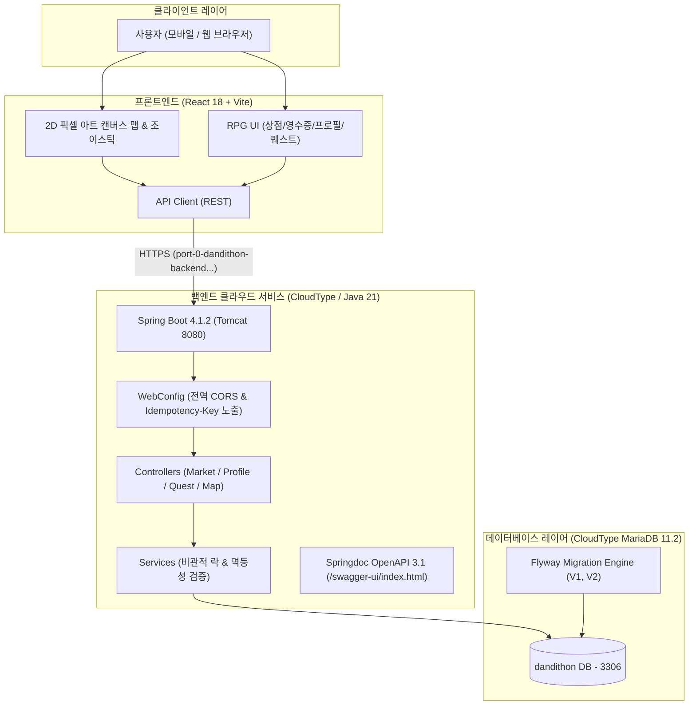

# 시스템 아키텍처 (Architecture)

> 시장에 가면 | 2026 단디톤

## 1. 개요

'시장에 가면'은 대구 서문시장을 배경으로 하는
위치 기반 2D 픽셀 아트 RPG 모바일 서비스입니다.

사용자는 실제 GPS 위치 또는 가상 조이스틱으로 시장을 탐험하고,
가게 NPC와 상호작용하며 가상 코인으로 음식을 구매할 수 있습니다.

본 문서는 서비스의 전체 시스템 구조와
프론트엔드·백엔드 간 역할 및 연동 방식을 정의하기 위한 문서입니다.

---

## 2. 기술 스택

> 2026 단디톤 개발팀 확정 스택

| 구분 | 기술 | 세부 사양 및 비고 |
|---|---|---|
| **Frontend** | React 18, Vite | 픽셀 아트 렌더링(HTML5 Canvas API), Lucide React 아이콘 |
| **Backend** | Java 21, Spring Boot | Spring Boot 4.1.2 (Tomcat 11), Spring Data JPA, Hibernate 7 |
| **Database** | MariaDB 11.2, H2 | 운영: CloudType MariaDB 11.2 / 로컬: H2 (File 모드) |
| **DB Migration** | Flyway | 스키마 버전 관리 (`V1__be1_schema.sql`, `V2__be2_schema.sql`) |
| **API Docs** | Springdoc OpenAPI | OpenAPI 3.1 명세 자동화 및 Swagger UI |
| **배포 환경** | CloudType | 클라우드 컨테이너 호스팅, 자동 HTTPS 및 도메인 라우팅 |
| **CI / CD** | GitHub + CloudType | `main` 브랜치 머지 시 Git Webhook 기반 무중단 자동 재배포 |
| **지도 및 위치** | Canvas 2D + GPS / 조이스틱 | 2D 그리드 좌표계 기반 충돌 및 이동 시뮬레이션 |
| **혼잡도 / AI** | 4단계 혼잡도 산출 엔진 | 대기시간(0~5, 5~10, 10~20, 20+) 매핑 및 NPC 대기열 렌더링 |

---

## 3. 시스템 구성도

---

## 4. 주요 구성 요소

### 4.1 Frontend

> FE 개발팀 작성 예정

주요 구현 대상:

- 시작 화면 및 메인 화면
- 2D 픽셀 아트 시장 맵
- GPS 기반 캐릭터 이동
- 가상 조이스틱 ON/OFF
- 가게 및 NPC 상호작용
- 음식 구매 및 영수증 UI
- 퀘스트 화면
- 프로필 및 캐릭터 커스터마이징
- API 연동

작성할 내용:

- 프론트엔드 프로젝트 구조
- 화면 및 컴포넌트 구성
- 상태 관리 방식
- GPS 및 조이스틱 처리 방식
- 백엔드 API 연동 방식

### 4.2 Backend

> BE 개발팀 작성 예정

주요 구현 대상:

- 사용자 및 프로필 데이터 관리
- 가게 및 음식 데이터 관리
- 게임 코인 구매 처리
- 구매 내역 및 영수증 관리
- 리뷰 데이터 관리
- 장비 및 배지 보상 처리
- 퀘스트 및 보상 관리
- API 제공

작성할 내용:

- 백엔드 프로젝트 구조
- 주요 서비스 및 모듈 구성
- 비즈니스 로직 처리 방식
- 데이터베이스 연동 방식
- API 설계 및 예외 처리

### 4.3 Database

> BE 개발팀 작성 예정

작성할 내용:

- 데이터베이스 선정
- ERD
- 주요 엔티티 및 테이블
- 데이터 간 관계
- 데이터 저장 및 조회 방식

### 4.4 예상 대기시간 및 혼잡도

> 개발팀 협의 후 작성

주요 기능:

- 가게별 예상 대기시간 제공
- 예상시간에 따른 혼잡도 구분
- 혼잡도에 따른 NPC 대기줄 표현

작성할 내용:

- 데이터 수집 및 관리 방식
- 예상시간 산출 방식
- Mock 데이터 사용 여부
- 대기시간과 NPC 수의 매핑 방식

※ 실제 AI 모델 사용 여부는 개발팀에서 확정합니다.
※ Mock 데이터를 사용하는 경우 실제 예측 결과와 구분합니다.

---

## 5. 주요 데이터 흐름

> FE·BE 협의 후 구체화

### 5.1 시장 탐험

1. 사용자가 메인 화면에 진입합니다.
2. 시장 맵과 가게 정보를 표시합니다.
3. GPS 또는 조이스틱 입력에 따라 캐릭터가 이동합니다.
4. 가게 선택 시 상세 정보를 표시합니다.

### 5.2 음식 구매

1. 사용자가 가게에서 상품을 선택합니다.
2. 구매 수량과 총 코인을 확인합니다.
3. Mock 구매를 요청합니다.
4. 코인을 차감하고 구매 내역을 생성합니다.
5. 영수증 화면에서 구매 결과를 확인합니다.

### 5.3 보상 획득

1. 음식 구매가 완료됩니다.
2. 음식별 누적 구매 횟수를 갱신합니다.
3. 장비 및 배지 획득 조건을 확인합니다.
4. 조건을 충족하면 보상을 지급합니다.
5. 프로필에서 획득한 보상을 확인합니다.

### 5.4 리뷰 작성

1. 사용자가 영수증을 확인합니다.
2. 조리 완료 상태의 음식을 선택합니다.
3. 리뷰를 작성합니다.
4. 작성한 리뷰를 저장합니다.
5. 프로필의 내 리뷰에서 확인합니다.

※ 위 내용은 기획서 기준의 논리적 흐름이며, 실제 API 호출 및 처리 구조는 개발팀이 확정합니다.

---

## 6. 개발 및 배포 환경

| 항목 | 내용 |
|---|---|
| **백엔드 배포 환경** | CloudType (Java 21, Spring Boot 4.1.2 실행 컨테이너) |
| **데이터베이스 배포 환경** | CloudType (MariaDB 11.2 인스턴스, 내부 포트 3306) |
| **프론트엔드 실행 환경** | Node.js 18+, Vite 개발 서버 (`http://localhost:5173`) |
| **운영 API 도메인** | `https://port-0-dandithon-backend-mw1mk9y6e7f0b691.sel3.cloudtype.app` |
| **Swagger UI** | `https://port-0-dandithon-backend-mw1mk9y6e7f0b691.sel3.cloudtype.app/swagger-ui/index.html` |
| **CI / CD 파이프라인** | GitHub `main` 브랜치 머지 시 CloudType 자동 Webhook 트리거 ➔ 빌드(`bootJar`) 및 무중단 재배포 |
| **로컬 백엔드 실행 방법** | `./gradlew bootRun` (내장 H2 파일 DB 모드로 환경변수 없이 단독 구동 가능) |
| **통합 테스트 실행** | `./gradlew test` (Be1, Be2 통합 테스트 총 21개 검증) |
| **주요 환경 변수** | `SPRING_PROFILES_ACTIVE`, `DB_URL`, `DB_USERNAME`, `DB_PASSWORD`, `SPRING_JPA_DATABASE_PLATFORM`, `SERVER_ADDRESS` |

---

## 7. 기술적 고려 사항

개발팀은 다음 사항을 검토합니다.

- GPS 이동과 조이스틱 이동의 상태 구분
- 캐릭터 위치 및 지도 좌표 처리
- 게임 코인 차감과 구매 내역의 일관성
- 중복 구매 및 중복 보상 방지
- FE·BE API 데이터 형식 일치
- Mock 데이터와 실제 데이터 구분
- 사용자 상태와 캐릭터 외형의 일관성

---

## 8. 참고 문서

- [서비스 요구사항](PRD.md)
- [API 명세](API.md)
- [작업 목록](TASKS.md)
- [프로젝트 소개](../README.md)

---

※ 본 문서는 초기 시스템 아키텍처 템플릿입니다.
※ 실제 기술 구조 및 설계는 개발팀에서 확정 후 작성합니다.
